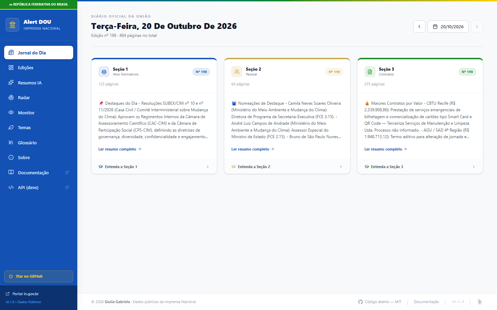
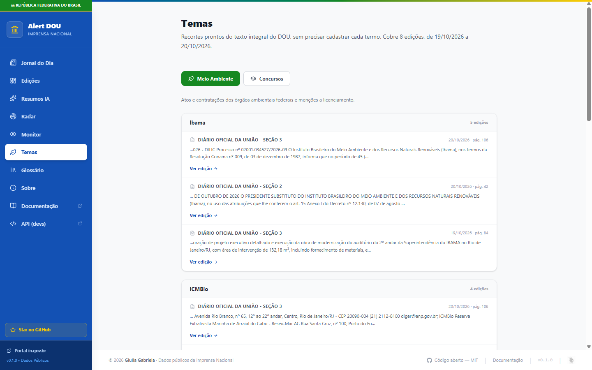
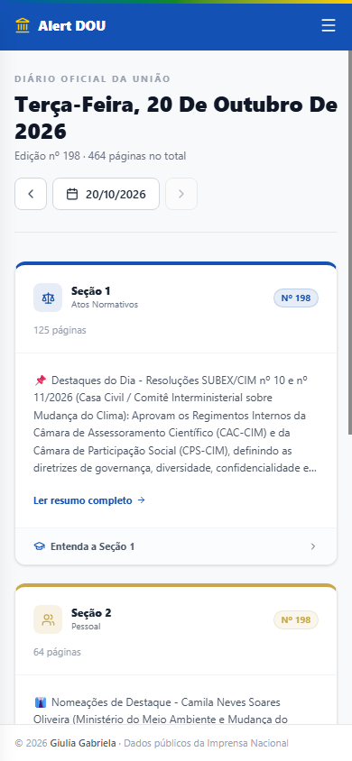

# Alert DOU

> A reader for Brazil's *Diário Oficial da União*: every page indexed and searchable, an AI summary per section, and a personal monitor for names, companies and topics.

[](https://github.com/Baniwa/Alert-DOU/actions/workflows/ci.yml)
[](https://python.org)
[](https://react.dev)
[](https://fastapi.tiangolo.com)
[](LICENSE)



---

## What is the DOU?

The *Diário Oficial da União* is Brazil's federal gazette, the equivalent of the US Federal Register. Appointments, dismissals, laws, decrees, public tenders and government contracts only take effect once they are published there. It comes out every weekday in three sections:

- **Seção 1**: regulatory acts (laws, decrees, ordinances, resolutions)
- **Seção 2**: personnel acts (appointments, dismissals, retirements)
- **Seção 3**: contracts, tenders and penalties applied to suppliers

A single section often runs past 200 pages. On 20 October 2026, Seção 3 alone had 275. If you are waiting for your appointment after a public exam, or following a company's contracts, you either read all of that or you miss it.

## What it does

- **Indexes every page.** A scheduler scrapes the day's editions at 08:00 and extracts the text of every page into PostgreSQL. Search is accent-insensitive, matches whole words and tells you the page.
- **Monitor.** Save people, CPFs, companies (CNPJ or name) and free terms. The app shows where each one appeared, flags what is new since your last visit, and lets you mark a company as one to avoid. The list stays in your browser.
- **CPF the way the DOU prints it.** The gazette masks CPFs (`***.456.789-**`), so the search matches the six middle digits and warns that the result may be someone else.
- **AI summary per section** with Gemini Flash, in a fixed structure per section, generated on demand and cached. Acronyms are spelled out on first mention. English translation on request.
- **Themes.** Ready-made searches for Environment (Ibama, ICMBio, Conama, MMA, environmental licensing, ANA) and Public exams.
- **Learning aids.** Each section on the home page explains what it publishes and the legal deadlines that matter (for example 30 days to take office after an appointment, Law 8.112/1990). A glossary covers act types, personnel and procurement terms and federal acronyms, citing the law where there is one.
- **Works on a phone.**

| Themes | Phone |
|---|---|
|  |  |

## Tech stack

| Layer | Technology |
|---|---|
| Scraper | Playwright + playwright-stealth (the portal's WAF blocks plain HTTP clients) |
| PDF download and text | curl-cffi (Chrome impersonation) + pypdfium2 |
| Search | PostgreSQL 16, one row per page, `pg_trgm` index over `unaccent(lower(text))` |
| AI | Google Gemini Flash (summaries and translation) |
| API | FastAPI + Pydantic + slowapi (rate limiting) |
| Jobs | `schedule` for the daily scrape and the indexer; Celery + Redis for backfills |
| Frontend | React 19, TypeScript, Tailwind CSS v4, Vite, TanStack Query |
| Infrastructure | Docker Compose: `api`, `worker`, `celery`, `db`, `redis` |

## Architecture

```
worker (scheduler)
  08:00      scrape pesquisa.in.gov.br with Playwright  ->  editions
  every 30m  download PDFs, extract every page          ->  edition_pages (trigram index)

celery       POST /editions/backfill queues one scrape per date

api (FastAPI)
  /editions/search     whole-word search over edition_pages, page and excerpt per edition
  /editions/{id}/summary   Gemini summary from the indexed text, cached in ai_summaries

frontend (React)
  Jornal do Dia · Monitor · Temas · Glossário · edition detail with summary
```

Signed PDF links on the DOU expire. When a download fails, the indexer scrapes that date again for fresh links and retries once; an edition is given up after five failed attempts.

## Running it locally

```bash
git clone https://github.com/Baniwa/Alert-DOU.git
cd Alert-DOU
cp .env.example .env        # set POSTGRES_PASSWORD and GEMINI_API_KEY
docker compose up -d        # api on :8000, runs migrations on start
```

`docker-compose.override.yml` mounts the source into the containers and runs uvicorn with `--reload`. It is meant for development only.

Frontend:

```bash
cd frontend
cp .env.example .env        # VITE_API_URL=http://localhost:8000
npm install
npm run dev                 # http://localhost:5173
```

Swagger UI is at `http://localhost:8000/docs`.

### Environment variables

| Variable | Required | Description |
|---|---|---|
| `POSTGRES_PASSWORD` | yes | PostgreSQL password |
| `GEMINI_API_KEY` | yes | Google AI Studio key |
| `POSTGRES_USER` / `POSTGRES_DB` | no | Default `alertdou` |
| `CORS_ORIGINS` | no | Comma-separated origins. Default `http://localhost:5173,http://localhost:4173` |
| `ENVIRONMENT` | no | `production` turns on HSTS |
| `ROOT_PATH` | no | Prefix when a reverse proxy serves the API under a path and strips it, e.g. `/api` |

## API

| Method | Path | Description |
|---|---|---|
| GET | `/editions/` | Editions, filterable by date |
| GET | `/editions/dates` | Dates that have editions |
| GET | `/editions/{id}` | One edition |
| GET | `/editions/{id}/summary` | Portuguese summary; generates it if missing. `?generate=false` only returns a saved one |
| GET | `/editions/{id}/summary/en` | English translation of the summary |
| GET | `/editions/search?q=` | Full-text search. CPF and CNPJ are converted to the format the DOU prints |
| GET | `/editions/coverage` | How many editions are indexed and for which period |
| POST | `/editions/fetch-date?date=YYYY-MM-DD` | Scrape one date now |
| POST | `/editions/backfill` | Queue scrapes for a date range |
| GET | `/summaries/` | Saved summaries |
| GET | `/summaries/search?q=` | Search inside summaries |

Every endpoint is rate limited per IP, from 3 per hour (backfill) to 60 per minute.

## Security

- PDF downloads only from an allowlist of `in.gov.br` hosts, HTTPS, default port (SSRF)
- CPFs are replaced with `[CPF]` in request logs
- `X-Content-Type-Options`, `X-Frame-Options`, `Cross-Origin-Opener-Policy`, `Cross-Origin-Resource-Policy`, `Permissions-Policy`, `Referrer-Policy`, and HSTS in production
- Request bodies over 64 KB are rejected
- The translation prompt tells the model to ignore instructions inside the text
- The Monitor list never leaves the browser

See [SECURITY.md](SECURITY.md) to report a vulnerability, and [CONTRIBUTING.md](CONTRIBUTING.md) for the branch and pull request flow.

## Why I built it

I am a developer and a *concurseira*, someone preparing for Brazilian federal civil service exams, and I spent hours every week checking the DOU by hand for appointment notices. This is the tool I wished I had.

---

Python 3.12 · React 19 · FastAPI · PostgreSQL · Gemini Flash
